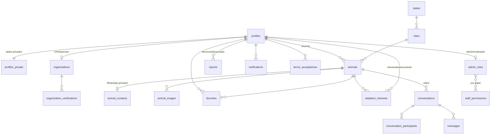

# Arquitetura do AdoteAmigo

## Visão geral

```mermaid
flowchart LR
  U[Navegador / celular] -->|HTTPS| V[Vercel — Next.js 16]
  V -->|Server Components e Server Actions\n(sessão via cookies)| S[(Supabase)]
  U -->|Upload de fotos direto\n(RLS do Storage)| ST[Supabase Storage]
  U -->|WebSocket — mensagens e notificações| RT[Supabase Realtime]
  S --- DB[(PostgreSQL + RLS)]
  S --- AUTH[Supabase Auth]
  RT --- DB
  ST --- DB
```

- **Leitura de dados:** Server Components consultam o Supabase com a sessão do usuário (cookies). O RLS decide o que cada pessoa pode ver.
- **Escrita:** Server Actions validam com Zod e gravam no banco. Gatilhos e funções no PostgreSQL aplicam as regras de negócio. Mesmo que alguém chame a API do Supabase diretamente, as regras continuam valendo.
- **Fotos:** comprimidas no navegador (WebP em 1600 px + miniatura de 640 px) e enviadas para `animal-images/{usuario}/{anuncio}/`. A política do Storage só permite gravar na própria pasta.
- **Tempo real:** o chat e o sino de notificações assinam `postgres_changes`. O Realtime aplica o mesmo RLS, então cada pessoa só recebe eventos das próprias conversas.
- **Proxy (`src/proxy.ts`):** renova a sessão a cada requisição e redireciona visitantes de `/painel` e `/admin` para o login. A autorização de verdade fica no banco e nas páginas (`requireUser`, `requirePermission`).

## Modelo de dados



Tabelas de apoio: `moderation_logs` (auditoria, sem FK para sobreviver à exclusão de contas), `platform_settings`
(versões dos termos, limites anti-spam, termos suspeitos), `rate_limit_events`, `user_blocks`, `adoption_stories`,
`contact_messages`, `states` e `cities` (5.570 municípios do IBGE com coordenadas).

Migrations versionadas em `supabase/migrations/`:

| Arquivo | Conteúdo |
|---|---|
| `…0100_schema.sql` | Tipos, tabelas, restrições e índices |
| `…0200_locations_data.sql` | Estados e municípios (IBGE) |
| `…0300_functions.sql` | Cadastro, publicação automática, risco, chat, interesses, moderação, LGPD |
| `…0400_security.sql` | Privilégios, RLS, busca do catálogo, buckets do Storage e Realtime |
| `…0500_contact_messages.sql` | Formulário de contato |
| `…0600_favorite_count.sql` | Contador de favoritos por anúncio |
| `…0700_admin_edit.sql` | Edição e sinalização de anúncios pela moderação |

## Segurança

| Ameaça | Mitigação |
|---|---|
| Usuário virar admin | `admin_roles` não tem nenhuma política de escrita para clientes. Só o backend (SQL ou service role) atribui papéis |
| Alterar campos sensíveis | Privilégios por coluna (`GRANT UPDATE (…)`) e gatilhos que rejeitam mudanças em status, verificação, slug, dono e contadores |
| Ler dados de terceiros | RLS em 100% das tabelas. Telefone e nascimento ficam em `profiles_private`, e o WhatsApp em `animal_contacts` |
| Ler conversas alheias | Somente participantes. A moderação só lê conversas **denunciadas** |
| Chamar funções internas | `REVOKE EXECUTE` em todas as funções e liberação explícita apenas das que formam a API |
| Spam | Limites por usuário e ação no banco (`platform_settings.rate_limits`), limite por IP no contato e honeypot |
| Golpes | Sinalização automática de termos de pagamento, links, telefones e publicações repetidas, avisos no chat e na página do animal |
| Uploads maliciosos | Bucket aceita só JPEG/PNG/WebP com até 5 MB, pasta obrigatória do usuário, conversão para WebP no cliente e máximo de 10 fotos |
| Redirecionamento aberto | `safeRedirect` aceita apenas caminhos internos |
| Enumeração de contas | Recuperação de senha responde igual para e-mails existentes e inexistentes |
| Clickjacking e afins | Cabeçalhos `X-Frame-Options`, `X-Content-Type-Options`, `Referrer-Policy`, `Permissions-Policy` e HSTS |
| Abuso pela equipe | Toda ação administrativa passa por função que exige motivo e grava em `moderation_logs` |

### Papéis e permissões

| Permissão | Admin | Moderador |
|---|:-:|:-:|
| dashboard.view, animals.moderate, reports.manage, users.view, users.suspend, conversations.review | ✅ | ✅ |
| users.block, organizations.verify, settings.manage, logs.view | ✅ | — |

Para criar um papel novo (ex.: "parceiro"), basta adicionar ao enum `staff_role` e inserir as linhas em
`staff_permissions`. O código usa `has_permission('…')`, nunca o nome do papel.

## LGPD e retenção

- **Aceite:** o cadastro só é concluído se as versões vigentes dos Termos e da Política forem aceitas (validação no banco). O aceite fica em `terms_acceptances` (documento, versão e data).
- **Idade:** o banco rejeita cadastros de menores de 18 anos (`minimum_age` em `platform_settings`).
- **Acesso e portabilidade:** `export_my_data()` gera um JSON com todos os dados do titular.
- **Exclusão:** apaga o usuário no Auth. A cascata remove perfil, anúncios, fotos, favoritos e interesses. Mensagens enviadas ficam sem autor (`sender_id = null`). Denúncias e auditoria mantêm apenas o mínimo para a segurança da comunidade.
- **Retenção técnica:** `purge_expired_data()` remove eventos anti-spam com mais de 7 dias, notificações lidas com mais de 180 dias e contatos atendidos com mais de 1 ano.

## Escalabilidade (preparado para o futuro)

| Expansão | O que já existe |
|---|---|
| Aplicativo móvel | Regras no banco (RLS e funções). Um app React Native pode usar o mesmo Supabase sem duplicar lógica |
| Perfis institucionais e painéis de ONG | `organizations`, verificações e selo, além de `profile_type` |
| Busca geográfica avançada | Coordenadas por cidade e função `distance_km`. Pode migrar para PostGIS sem mudar a interface |
| Alertas personalizados | Filtros já são parâmetros de URL serializáveis, e as `notifications` têm tipo e link |
| Campanhas e estatísticas públicas | `public_stats()`, `adoption_stories`, `view_count` e `favorite_count` |
| Moderadores e parceiros | `staff_permissions` configurável por papel |
| Integrações | `platform_settings` em JSON e Server Actions isoladas por domínio (`src/app/actions/*`) |
| Volume | Índices por filtro, busca textual em português (tsvector + unaccent) e trigramas para raça e nome |
